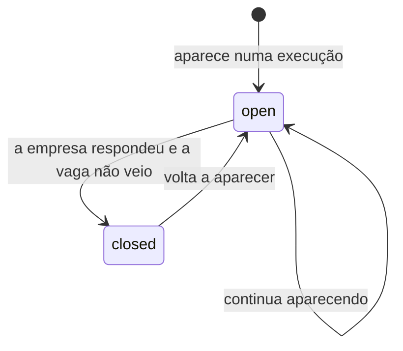

# Banco e arquivos

SQLite local em `data/vagas.db` (`%APPDATA%\vagas1000\data` no app instalado). Nada sai da sua máquina.

## Tabelas

| Tabela | Conteúdo |
| --- | --- |
| `companies` | As empresas da configuração, com adaptador e nota composta |
| `runs` | Uma linha por execução: total, elegíveis, novas e encerradas |
| `run_companies` | Resultado de cada empresa em cada execução (ok, quantidade, erro) |
| `jobs` | Uma linha por vaga (`job_key`) com o **registro completo** (veja [Seu banco de vagas](/guia/banco-de-vagas)): campos padronizados, descrição em HTML, seções, metadados, payload bruto, nota, veredito, datas e `versions` |
| `job_snapshots` | Nota e veredito de cada vaga em cada execução (histórico) |
| `job_versions` | **Versão completa** da vaga (texto, HTML, seções, salário, locais) e o payload bruto, a cada mudança de conteúdo |
| `v_open_jobs` | Visão das vagas abertas, ordenadas por veredito e nota |

## Regras de ciclo de vida

- Uma vaga só é marcada como **encerrada** se a empresa dela respondeu com sucesso naquela execução. Empresa fora do ar não encerra nada.
- Se **todas** as empresas falharem, a execução não é gravada.
- “Novas” são as de `first_run_id` igual ao da última execução.
- **Nada é apagado**: vaga encerrada continua com todos os campos e ganha `closed_at`.
- **Captura parcial não apaga**: campo que a execução de hoje não trouxe (detalhe não reaberto) mantém o valor já guardado.
- **Versões**: `content_hash` resume título, texto, local e salário; se mudar, nasce uma linha em `job_versions` e `versions` sobe.
- **Detalhes em cache** (Gupy e Workday): o detalhe lido há menos de 7 dias é reaproveitado do banco; a primeira execução lê tudo, as seguintes só o que é novo ou velho.
- **Migração**: bancos antigos ganham as colunas novas ao abrir (`PRAGMA user_version = 2`); só acrescenta, nunca altera nem apaga.

## Saídas

| Arquivo | O que é |
| --- | --- |
| `out/dashboard.html` | Painel offline: lista, registros completos (sem o payload bruto), estilos e fontes embutidos |
| `out/banco-vagas.json` | Exportação completa (`--exportar`): todas as vagas, versões e payload bruto |
| `out/presenciais.md` | Vagas presenciais agrupadas por estado e cidade |
| `out/vagas-latest.json` e `.csv` | Captura completa, com `status` por empresa |
| `out/vagas-AAAAMMDD-HHMMSS.*` | Cópias de cada execução; o projeto guarda as **60 mais recentes** |
| `out/status.json` | Progresso da execução em andamento (a janela lê a cada 500 ms) |
| `logs/scraper.log` | Log detalhado de cada execução |

## Backup

Copie a pasta `%APPDATA%\vagas1000` (ou só `data\vagas.db` e `config\`). Para usar outra pasta, defina `VAGAS1000_HOME` antes de abrir o app.
