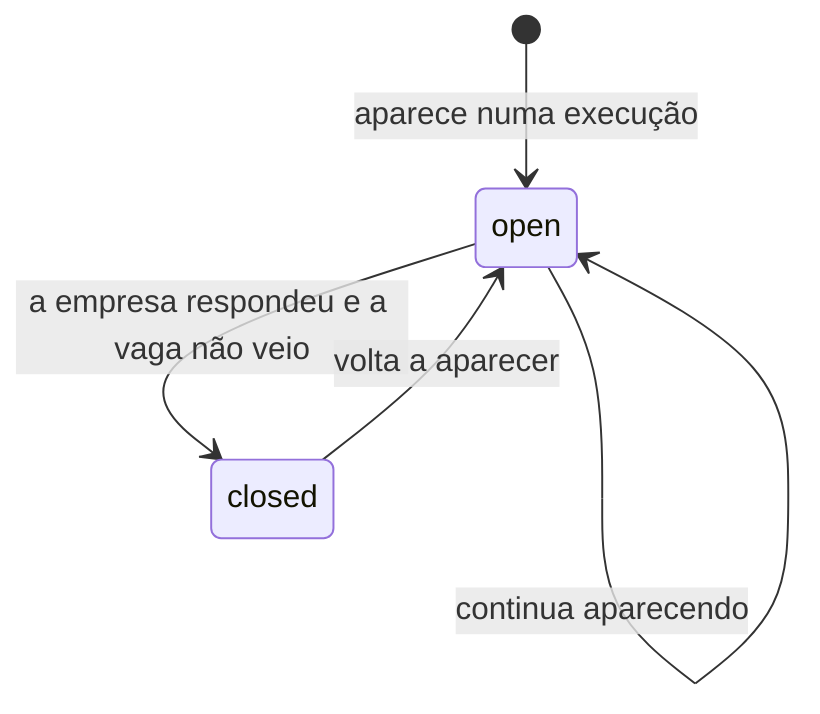

# Banco e arquivos

SQLite local em `data/vagas.db` (`%APPDATA%\vagas1000\data` no app instalado). Nada sai da sua máquina.

## Tabelas

| Tabela | Conteúdo |
| --- | --- |
| `companies` | As empresas da configuração, com adaptador e nota composta |
| `runs` | Uma linha por execução: total, elegíveis, novas e encerradas |
| `run_companies` | Resultado de cada empresa em cada execução (ok, quantidade, erro) |
| `jobs` | Uma linha por vaga (`job_key`) com o **registro completo** (veja [Seu banco de vagas](/guia/banco-de-vagas)): campos padronizados, descrição em HTML, seções, metadados, payload bruto, nota, veredito, datas e `versions` |
| `job_snapshots` | Nota e veredito de cada vaga em cada execução. **Só até a 1.4**: desde o histórico dia a dia não recebe linhas novas (as existentes ficam) |
| `job_events` | **Histórico dia a dia**: só o que mudou. Uma linha por (dia, vaga, tipo, campo): `entrou`, `saiu`, `voltou` ou `mudou` (titulo, local, modalidade, contrato, salario, descricao, veredito, nota), com o valor do começo e o do fim do dia |
| `day_summary` | Uma linha por **data**: abertas no fim do dia, entradas, saídas, mudanças, elegíveis, cobertura de fontes e os indicadores do card |
| `job_versions` | **Versão completa** da vaga (texto, HTML, seções, salário, locais) e o payload bruto, a cada mudança de conteúdo |
| `v_open_jobs` | Visão das vagas abertas, ordenadas por veredito e nota |

## Regras de ciclo de vida

- Uma vaga só é marcada como **encerrada** se a empresa dela respondeu com sucesso naquela execução. Empresa fora do ar não encerra nada.
- Se **todas** as empresas falharem, a execução não é gravada.
- “Novas” são as de `first_run_id` igual ao da última execução.
- **Nada é apagado**: vaga encerrada continua com todos os campos e ganha `closed_at`.
- **Captura parcial não apaga**: campo que a execução de hoje não trouxe (detalhe não reaberto) mantém o valor já guardado.
- **Versões**: `content_hash` resume título, texto, local e salário; se mudar, nasce uma linha em `job_versions` e `versions` sobe.
- **Detalhes em cache** (Gupy, Workday e GFT): o detalhe lido há menos de 7 dias é reaproveitado do banco; as execuções seguintes priorizam o que é novo ou antigo, dentro do limite configurado.
- **Migração**: bancos antigos ganham as colunas novas ao abrir (`PRAGMA user_version = 2`); só acrescenta, nunca altera nem apaga.

## Histórico dia a dia

O **dia é a data** (calendário, horário local) em que a extração começou. Várias extrações no mesmo dia viram um dia só: o app guarda **só o que mudou**, e cada vaga tem no máximo um evento por (dia, tipo, campo), do valor do começo do dia ao do fim.

- **Entrou / saiu / voltou**: na primeira extração de um dia, a vaga que não aparece mais e cuja fonte respondeu vira `saiu` naquela data. Fechar e reabrir no mesmo dia se anula; vaga que abre e fecha no mesmo dia mantém os dois eventos (vaga relâmpago).
- **Mudou**: um evento por campo. Voltar ao valor de antes no mesmo dia apaga o evento. Campo que estava vazio e foi preenchido depois (detalhe aberto numa busca seguinte) **não** conta; salário que aparece conta. Nota só entra com mudança de 10 pontos ou mais.
- **Linha de base**: o primeiro dia do banco não tem "entradas"; é o ponto de partida.
- **Fonte sem leitura** nunca fecha vagas; o resumo do dia lista as fontes que falharam (`failing`) e quantas vagas guardadas ficaram sem verificação (`unverified_open`).
- **Feed parcial da GFT**: as vagas que deixam de aparecer no feed não são automaticamente encerradas, pois o feed contém apenas publicações recentes.
- **Dia sem extração**: o resumo do dia seguinte traz `gap_days`; as mudanças aparecem nele, acumuladas.
- **Perfil**: se o `profile.json` muda, quase todas as vagas trocam de veredito de uma vez; nesse caso a execução não gera eventos de veredito/nota.
- **Migração**: o primeiro uso da versão com histórico reconstrói os eventos a partir de `jobs`, `job_versions` e `job_snapshots` e guarda antes uma cópia em `vagas.db.bak-antes-do-historico`.

Os indicadores dos cards são módulos configuráveis em `config/historico.json` (ligar/desligar, limites, quantos aparecem por card).

## Saídas

| Arquivo | O que é |
| --- | --- |
| `out/dashboard.html` | Painel offline: lista, registros completos (sem o payload bruto), estilos e fontes embutidos |
| `out/banco-vagas.json` | Exportação completa (`--exportar`): todas as vagas, versões e payload bruto |
| `out/vagas-latest.json` e `.csv` | Captura completa, com `status` por empresa |
| `out/vagas-AAAAMMDD-HHMMSS.*` | Cópias de cada execução; o projeto guarda as **60 mais recentes** |
| `out/status.json` | Progresso da execução em andamento (a janela lê a cada 500 ms) |
| `logs/scraper.log` | Log detalhado de cada execução |

## Backup

Copie a pasta `%APPDATA%\vagas1000` (ou só `data\vagas.db` e `config\`). Para usar outra pasta, defina `VAGAS1000_HOME` antes de abrir o app.
