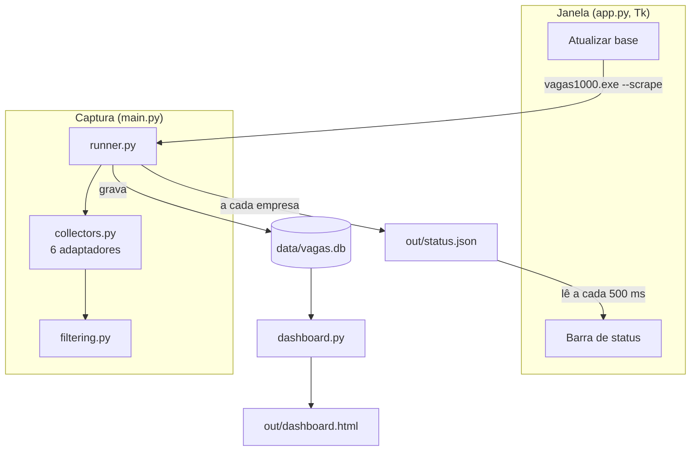

# Visão da arquitetura

Python puro, sem servidor. A janela é Tk; a captura roda num processo separado; tudo conversa por arquivos e pelo SQLite.

## Módulos

| Arquivo | Responsabilidade |
| --- | --- |
| `app.py` | Janela, botões, barra de status. Também é o ponto de entrada do executável (`--scrape` chama o `main`) |
| `main.py` | Linha de comando: captura, `--painel`, `--reavaliar` |
| `scraper/runner.py` | Percorre as empresas, isola falhas, grava `status.json`, saídas e banco; abre o Chrome **sob demanda** |
| `scraper/collectors.py` | Um coletor por tipo de fonte |
| `scraper/parsers.py` | Interpreta HTML/JSON de cada fonte (testado com fixtures) |
| `scraper/filtering.py` | Filtros por título, localização e a nota |
| `scraper/db.py` | Esquema SQLite, `save_run`, reavaliação |
| `scraper/dashboard.py` / `reports.py` | Painel HTML e exportação do banco (`--exportar`) |
| `scraper/paths.py` | Onde ficam os arquivos (código-fonte × instalado) |
| `scraper/theme.py` | Tokens Nevora para o Tk |
| `scraper/version.py` | Versão única |

## Decisões

| Decisão | Por quê |
| --- | --- |
| API pública em vez de abrir o board no navegador | O Greenhouse novo renderiza no máximo 50 vagas (a C6 tem 157); a API traz tudo e a descrição junto, sem abrir vaga por vaga |
| Selenium só na Stone | Portal próprio sem API; é a única fonte que precisa de Chrome |
| Chrome sob demanda | Antes, sem Chrome a execução inteira abortava, mesmo com 53 empresas sem Chrome |
| Uma empresa falhar não derruba as outras | Cada coletor roda isolado; o erro vai para o relatório |
| Não grava no banco se **todas** falharem | Evita marcar todas as vagas como encerradas por uma queda de rede |
| Vaga some só se a empresa respondeu | Encerrada = a empresa respondeu com sucesso e a vaga não estava lá |
| Dois diretórios (`BUNDLE` e `HOME`) | O pacote é somente leitura; banco, painel e configuração editável ficam em `%APPDATA%\vagas1000` |
| Janela e captura em processos separados | A janela não trava durante a captura; o progresso chega por `out/status.json` |
