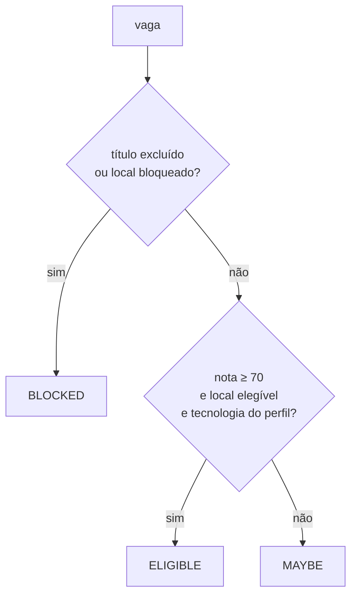

# Pontuação e elegibilidade

Toda vaga recebe uma **nota de 0 a 100** e um **veredito**. Os pesos e termos vivem em `config/profile.json`; a lógica, em `scraper/filtering.py` (`score_job`).

## A nota

| Componente | Peso | Como pontua |
| --- | --- | --- |
| **Título** | 30 | Cheio se o título tem um termo da área (`title_include_area`); 30% se não; zero se tem termo excluído |
| **Tecnologia** | 35 | Tecnologia do perfil (`core_tech`) no título conta cheio; na descrição conta uma fração (`description_hit_factor`, 0,4). Tecnologias “genéricas” (IA, integração, GraphQL) só contam no título. Satura em `tech_weight_cap` |
| **Senioridade** | 15 | Cheio se o título tem sênior, staff, lead etc.; 40% se não |
| **Elegibilidade** | 20 | Pelo local, abaixo |

## Elegibilidade de local

| Local na vaga | Resultado | Por quê |
| --- | --- | --- |
| `Brazil`, `São Paulo, SP`, `Remoto` | **ELIGIBLE** | Você pode aplicar |
| `Remote - LATAM`, `Latin America`, `Worldwide`, `Anywhere` | **ELIGIBLE** | Remoto contratando na região |
| `Remote - USA`, `Portugal`, `Bogota`, `Toronto` | **BLOCKED** | Exige presença em outro país |
| Remoto sem país, ou local vazio | **MAYBE** (metade dos pontos) | Não dá para saber |

## O veredito

`eligible_min_score` (70) é o corte. Mudou o perfil? Rode `python main.py --reavaliar`: as vagas já salvas são reavaliadas sem nova captura.

::: tip Exemplo
Com o perfil de exemplo, “Senior Salesforce Developer — Brazil (Remote)” soma título (30) + Salesforce no título (35) + “Senior” (15) + Brasil (20) = **100, ELIGIBLE**. “Salesforce Administrator — São Paulo, SP” só perde a senioridade (15 → 6) e fica em **91, ELIGIBLE**. Já “Senior Backend Engineer — United States (Remote)” é **BLOCKED**, qualquer que seja a nota.
:::

## Perfil de exemplo

O `profile.json` que acompanha o projeto é o da autora: Salesforce (6 anos), AWS, Go, Python, TypeScript/Node, Angular/React, IA generativa e integração. **Troque pelos seus termos** antes de confiar na nota.
