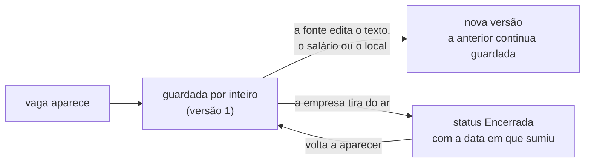

# Seu banco de vagas

O vagas1000 não é só uma lista de links. Cada vaga que ele vê fica **guardada por inteiro** no banco local. Quando a empresa tira a vaga do ar, tudo o que ele já tinha continua aqui: texto, salário, locais, datas, etapas do processo e o dado original que a fonte enviou.

## O que fica guardado em cada vaga

| Grupo | Campos |
| --- | --- |
| **Identificação** | Empresa, título, fonte (Greenhouse, Lever, Ashby, Gupy, Workday, Stone), id na fonte, número da requisição |
| **Onde e como** | Local principal, **todos** os locais, modalidade (remoto, híbrido, presencial), tipo de contrato, área e time |
| **Remuneração** | Faixa salarial como a fonte publicou, mínimo, máximo, moeda e período (quando a fonte informa) |
| **Datas** | Publicação, última edição na fonte, prazo de inscrição, primeira e última vez que você a viu, quando saiu do ar |
| **Conteúdo** | Descrição completa em HTML limpo (títulos, listas e links preservados), seções (requisitos, benefícios, etapas do processo seletivo) e o texto puro |
| **Análise** | Nota, veredito, tecnologias encontradas e os motivos da nota |
| **Origem** | Links da vaga e da candidatura, metadados da fonte e o **payload bruto** exatamente como chegou |
| **Histórico** | Cada versão do conteúdo, com a data e o que mudou |

::: info O que depende da fonte
Nem toda fonte informa tudo. Salário, por exemplo, só aparece quando a empresa o publica (Greenhouse, Lever e Ashby têm campos próprios; Gupy e Workday raramente). O que a fonte não envia fica em branco, e o payload bruto guarda o que veio.
:::

## Quando a vaga some



Nada é apagado. Uma vaga encerrada continua no painel (em **Filtros**, marque **Mostrar encerradas**) e na página completa, com tudo que foi capturado.

Duas regras protegem o que já foi guardado:

- **Captura parcial não apaga.** Se numa execução o detalhe de uma vaga não foi reaberto (limite de velocidade, falha de rede), os campos que já estavam guardados continuam.
- **Só edição de verdade vira versão.** A versão nova só nasce quando título, texto, local ou salário mudam. Abrir de novo a mesma vaga sem mudança não cria nada.

## Ver no painel

O painel tem dois jeitos de olhar a lista, e uma página completa por vaga:

- **Cards**: informações padronizadas (empresa, título, local, modalidade, contrato, salário, data de publicação, tecnologias, nota, veredito e se é nova ou encerrada).
- **Tabela**: a mesma lista, compacta e ordenável.
- **Página da vaga** (clique no card ou na linha): resumo, descrição completa, seções, motivos da nota, dados do seu banco, histórico de versões, metadados da fonte e os dados brutos. Dá para abrir a vaga original, copiar o link, **baixar o registro em JSON** e imprimir.

A busca pode incluir a **descrição**: em **Filtros**, marque “Buscar também na descrição” para achar vagas por qualquer palavra do texto.

## Trazer vagas de fora (LinkedIn, planilha)

Nem toda vaga vem de um portal que o vagas1000 lê sozinho. O LinkedIn, por exemplo, não tem feed público. Para esses casos, o app **importa** uma captura feita à parte (pelo Claude no Chrome, por uma planilha, por outro programa) e a trata como as demais: cai no banco, ganha nota e veredito, aparece nos cards e tem página completa.

```bash
python main.py --importar imports/linkedin-salesforce-2026-11-16.json
```

Na janela do app é o botão **Importar vagas**: escolha o arquivo e pronto.

| Formato | Como é lido |
| --- | --- |
| **JSON** | Uma lista de vagas, ou um objeto com `vagas`/`jobs`. Chaves opcionais no topo: `fonte`, `capturado_em` (base das datas “há 3 dias”) e `origem` |
| **CSV / TSV** | Primeira linha com os nomes das colunas |
| **Tabela Markdown** | Como a que o Claude costuma devolver |

As colunas são reconhecidas em português e inglês: `Vaga`/`title`, `Empresa`/`company`, `Local`/`location`, `Link`/`url` (aceita `=HYPERLINK(...)` de planilha), `Publicada`/`posted`, `Modelo / contrato`, `Requisitos / stack`/`description`, `Salário / benefícios`, `Senioridade`, `Candidaturas`, `Aderência`, `Observações`. O que não tem coluna própria vai para os metadados, e a **linha original inteira fica guardada** no registro bruto: nada se perde.

Regras da importação:

- **Idempotente**: importar o mesmo arquivo de novo não duplica nem cria versão. Importar uma captura mais nova atualiza as vagas que já existem (pelo número da vaga no LinkedIn) e acrescenta as novas.
- **Não encerra nada**: um arquivo é um recorte, não uma varredura; vagas antigas continuam abertas.
- **Datas relativas viram datas**: “há 3 dias”, “há 10 h” e “ontem” são calculadas a partir de `capturado_em` (ou da data do arquivo).
- **Salário × benefícios**: texto com valor em dinheiro (“R$ 14K/mês”) vira salário; o resto (“VA/VR, saúde”) vira a seção **Benefícios**.
- **A nota é a do app**: a coluna “Aderência” da planilha fica nos metadados como *aderência (planilha)*, ao lado da nota calculada pelo seu `profile.json`. As duas podem divergir: a do app é por regra; ajuste os termos do perfil se quiser que as duas conversem.

## Usar a base fora do app

```bash
python main.py --exportar            # out/banco-vagas.json
python main.py --exportar minhas-vagas.json
```

O arquivo traz **todas** as vagas (abertas e encerradas) com todos os campos, o payload bruto e o histórico de versões, pronto para planilha, notebook ou outro sistema. O banco em si é um SQLite comum (`data/vagas.db`) que você pode abrir no DB Browser for SQLite, ou consultar com `sqlite3`.

```sql
-- vagas encerradas, mais recentes primeiro
SELECT company_name, title, posted_at, closed_at FROM jobs
WHERE status = 'closed' ORDER BY closed_at DESC;

-- vagas que a fonte editou
SELECT company_name, title, versions FROM jobs WHERE versions > 1;
```

## Tamanho

O registro completo pesa mais que a lista de antes: algumas dezenas de MB para mais de mil vagas, e cresce devagar (só as edições e as vagas novas acrescentam). O painel não carrega o payload bruto para não pesar; ele é lido do banco quando você o pede, no app.
