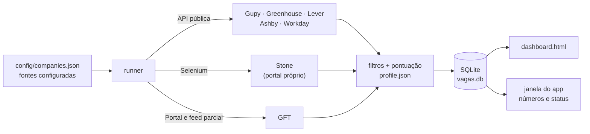

# Produto e escopo

O **vagas1000** responde a uma pergunta: *entre as vagas abertas hoje nas empresas que me interessam, quais eu realmente posso e quero aplicar?*

O cadastro padrão da versão 1.7.1 tem 76 fontes, incluindo bancos, fintechs, consultorias, indústria, varejo e saúde. Uma delas é um feed parcial adicional da GFT. O app lê as fontes disponíveis, pontua as vagas capturadas e guarda os resultados em um banco local.

## O que ele faz

- **Captura** as fontes configuradas, com status individual; uma falha não derruba as outras.
- **Filtra e pontua** cada vaga: título, tecnologias, senioridade e se *você pode aplicar* (Brasil, LATAM, remoto mundial) ou se a vaga exige estar em outro país.
- **Guarda o histórico** em SQLite: o que é novo desde a última execução, o que foi encerrado, a nota de cada vaga ao longo do tempo.
- **Gera o painel** `dashboard.html` (autossuficiente, offline).
- **Mostra o progresso** na janela: fonte atual, quantidade concluída, tempo e erros.
- **Busca no LinkedIn** (opcional, só na instalação pelo código-fonte) em modo seguro, usando a sua própria sessão do Chrome.

## O que ele não faz

::: info Escopo deliberado
O vagas1000 **não envia candidaturas nem mensagens**. A captura nos portais é somente leitura. No painel integrado, a usuária pode enviar uma vaga ao [CAM](https://github.com/nataliatobiasdev/agregador-carreiras) como oportunidade pendente; a confirmação da candidatura é feita no CAM.
:::

## Numa figura

