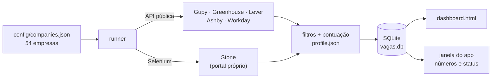

# Produto e escopo

O **vagas1000** responde a uma pergunta: *entre as vagas abertas hoje nas empresas que me interessam, quais eu realmente posso e quero aplicar?*

Ele abre os portais de vagas de 54 empresas (bancos, fintechs, consultorias, indústria, varejo, saúde), lê cada vaga, pontua pelo seu perfil e guarda tudo num banco local. Você acompanha pela janela do app ou pelo painel HTML.

## O que ele faz

- **Captura** as vagas das 54 empresas em uma execução, com status por empresa (uma que falha não derruba as outras).
- **Filtra e pontua** cada vaga: título, tecnologias, senioridade e se *você pode aplicar* (Brasil, LATAM, remoto mundial) ou se a vaga exige estar em outro país.
- **Guarda o histórico** em SQLite: o que é novo desde a última execução, o que foi encerrado, a nota de cada vaga ao longo do tempo.
- **Gera o painel** `dashboard.html` (autossuficiente, offline).
- **Mostra o progresso** na janela, numa barra estilo player: empresa atual, “12 de 54”, tempo, erros.
- **Busca no LinkedIn** (opcional, só na instalação pelo código-fonte) em modo seguro, usando a sua própria sessão do Chrome.

## O que ele não faz

::: info Escopo deliberado
O vagas1000 **não se candidata**, não envia mensagens e não grava nada em nome de ninguém. A captura é somente leitura. Para registrar candidaturas e acompanhar processos seletivos existe o [CAM](https://github.com/nataliatobiasdev/agregador-carreiras), aplicativo à parte; os dois não compartilham dados.
:::

## Numa figura

