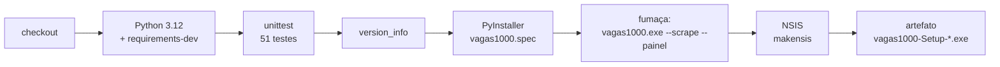
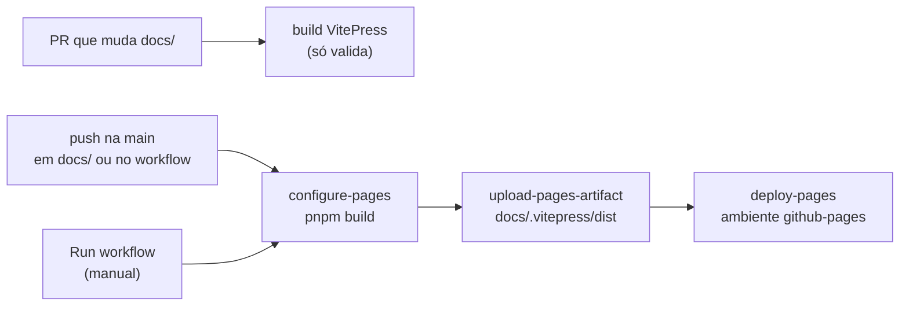

# CI e GitHub Pages

Três workflows, cada um com um trabalho só. É o mesmo desenho do CAM: o CI valida, o Docs publica o site, o Release publica o instalador.

| Workflow | Quando roda | O que faz |
| --- | --- | --- |
| `ci.yml` | Todo PR e push na `main` | Testes, empacota, **teste de fumaça do `.exe`**, gera o instalador e o guarda como artefato |
| `docs.yml` | PR (só valida) e push na `main` que altere `docs/` | Build do VitePress e publicação no Pages |
| `release.yml` | Tag `v*` | Confere a versão, gera o instalador e cria a Release |

## ci.yml

Em `windows-latest`, timeout de 30 min:

O **teste de fumaça** abre o executável empacotado com `VAGAS1000_HOME` numa pasta temporária e exige que `out/dashboard.html` e `config/companies.json` existam. Ele pega o que o teste unitário não pega: arquivo de dados esquecido na spec, importação que só falha congelada.

Para obter o instalador: aba **Actions** → run verde → artefato `installer`.

## docs.yml e o Pages

Roda no Ubuntu e é **o único workflow que publica no Pages**.

| Configuração | Valor |
| --- | --- |
| Fonte do Pages (Settings → Pages) | **GitHub Actions** |
| Endereço | `https://nataliatobiasdev.github.io/vagas-1000/` |
| Concorrência | Um deploy por ref; o mais novo cancela o anterior |
| Histórico completo (`fetch-depth: 0`) | Necessário para o “Atualizado em” de cada página |

::: warning Um só publicador
Dois workflows publicando no mesmo ambiente `github-pages` se sobrescrevem: vence o último deploy. Foi o que aconteceu no CAM quando o modelo “Static HTML” do GitHub criou um `static.yml`. Ao ativar o Pages, **não aceite nenhum modelo sugerido**: o `docs.yml` já cobre o deploy.
:::

## Primeiro uso

1. Faça o push da `main`.
2. *Settings → Pages → Build and deployment → Source: **GitHub Actions***.
3. Rode o workflow **Docs** manualmente (*Actions → Docs → Run workflow*) na primeira vez, porque o push inicial pode ter acontecido antes de o Pages estar ativo.
