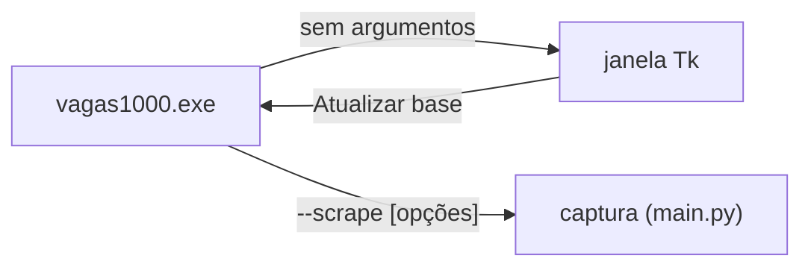
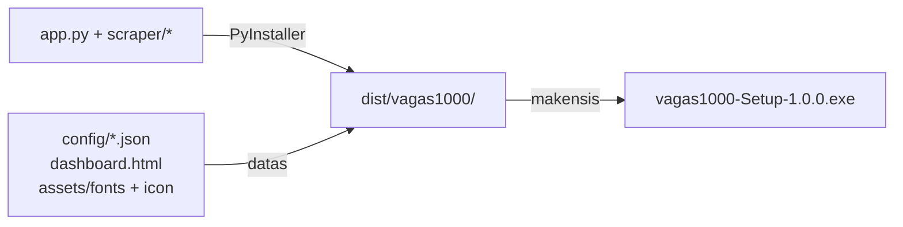

# Instalador Windows

| Configuração | Efeito |
| --- | --- |
| PyInstaller, modo pasta (`vagas1000.spec`) | `dist/vagas1000/vagas1000.exe` com o Python e as dependências embutidos; sem console |
| NSIS (`installer/vagas1000.nsi`) | Instalador `vagas1000-Setup-1.0.0.exe` |
| `RequestExecutionLevel user` | Instalação por usuário, **sem administrador** |
| Pasta padrão `%LOCALAPPDATA%\Programs\vagas1000` | O assistente deixa trocar a pasta |
| Atalhos na Área de Trabalho e no Menu Iniciar | Nome “vagas1000” |
| Desinstalador | Remove o programa e os atalhos; **nunca** apaga `%APPDATA%\vagas1000` |
| Ícone e metadados | `assets/icon.ico` no executável, no instalador e no desinstalador; versão em `installer/version_info.txt` |
| `collect_all("selenium")` na spec | Leva o `selenium-manager.exe`, que baixa o chromedriver certo |

## Como obter

- **GitHub**: [Releases](https://github.com/nataliatobiasdev/vagas-1000/releases) (a cada tag) ou o artefato `installer` de um run do CI.
- **Local** num Windows com Python 3.12 e NSIS: veja [Instalação](/guia/instalacao#gerar-o-instalador-voce-mesma).

## Um executável, dois modos

O mesmo `vagas1000.exe` abre a janela ou faz a captura, sem precisar de um Python separado:

O botão **Atualizar base** inicia o próprio executável com `--scrape --no-open` e acompanha `out/status.json`. Por isso o app instalado não depende de `python.exe`.

## Pacote

## Limites

::: info Sem assinatura de código
O instalador não é assinado. Na primeira execução o SmartScreen mostra “Editor desconhecido”: **Mais informações → Executar assim mesmo**.
:::

- O módulo do LinkedIn **não** vai no pacote (só na instalação pelo código-fonte).
- O Chrome precisa estar instalado, só para a Stone.
- Os antivírus às vezes marcam executáveis do PyInstaller como suspeitos (falso positivo comum). Gerar o instalador pelo CI, a partir do código, é a forma de provar a origem.
