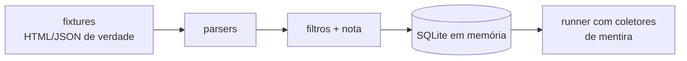

# Testes

`python -m unittest discover -s tests` roda **82 testes em poucos segundos**, sem rede e sem Chrome.

| Arquivo | Testes | O que cobre |
| --- | --- | --- |
| `tests/test_parsers.py` | 29 | Interpretação do HTML/JSON de cada fonte (Greenhouse, Lever, Ashby, Gupy, Stone), com fixtures reais em `tests/fixtures/` |
| `tests/test_db.py` | 8 | Gravação de execuções, vagas novas, encerradas e reabertas; “todas falharam” não grava |
| `tests/test_runner.py` | 9 | Sessão do Chrome que morre (retentativa), Chrome sob demanda, falta de Chrome, regressão da janela, criação da configuração |
| `tests/test_collectors.py` | 4 | Filtros por empresa (título, local, deduplicação) |
| `tests/test_config.py` | 2 | `companies.json` e `profile.json` válidos |
| `tests/test_importer.py` | 6 | Importação de vagas de fora: colunas em português e inglês, CSV, Markdown, datas relativas, salário × benefícios, idempotência |
| `tests/test_gfx.py` | 6 | Superfícies arredondadas, cache, ícones, cápsulas e fundo da janela |
| `tests/test_record.py` | 18 | Registro completo por fonte, HTML limpo (sem script nem imagem), migração, versões, cache de detalhes, painel e janela do painel |

## O que cada camada garante

- **Parsers com fixtures**: se um portal mudar o HTML, o teste falha com o trecho exato, sem depender da rede.
- **Banco de verdade**: SQLite em memória, não um mock; as regras de “encerrada” e “reaberta” rodam no motor real.
- **Runner com coletores de mentira**: verifica isolamento de falhas e a abertura do Chrome sem navegador.

## O que os testes não cobrem

- Chamadas de rede reais: validadas por uma coleta ao vivo na [rodada de testes](/qualidade/relatorio), não em CI (os portais mudam e limitam acesso).
- A janela Tk, além da regressão do `NameError`. Hoje é conferida à mão.
- O instalador NSIS: validado pelo CI ao gerar o `.exe`.

## Adicionar um teste

1. Salve a resposta real do portal em `tests/fixtures/` (HTML ou JSON).
2. Escreva o teste em `tests/test_parsers.py` apontando para a fixture.
3. `python -m unittest tests.test_parsers -v`.
