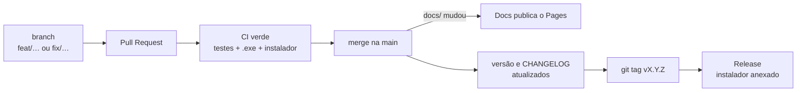

# Versionamento

O projeto usa [SemVer](https://semver.org/lang/pt-BR/) (`MAJOR.MINOR.PATCH`) e um [CHANGELOG](https://github.com/nataliatobiasdev/vagas-1000/blob/main/CHANGELOG.md) no formato *Keep a Changelog*.

| Parte | Quando sobe | Exemplo |
| --- | --- | --- |
| **PATCH** | Correção sem mudar o que o usuário vê | 1.0.1: Workday com mais pausas |
| **MINOR** | Funcionalidade nova compatível (empresa, fonte, filtro) | 1.1.0: nova fonte de vagas |
| **MAJOR** | Muda o formato dos dados ou exige ação do usuário | 2.0.0: novo esquema do banco |

## Uma fonte só da versão

`scraper/version.py` guarda `__version__`. Dela saem o número na janela, os metadados do `.exe` (`scripts/make_version_info.py`), o nome do instalador (`vagas1000-Setup-X.Y.Z.exe`) e a conferência do release.

## Fluxo, igual ao do CAM



1. Trabalhe num branch e abra um **Pull Request**; o CI precisa ficar verde.
2. Depois do merge, no branch de lançamento: altere `scraper/version.py` e mova as entradas de *Não lançado* para a nova versão no `CHANGELOG.md`.
3. Crie e envie a tag:

```bash
git tag v1.0.0
git push origin v1.0.0
```

4. O workflow **Release** confere se a tag bate com `version.py`, roda os testes, gera o instalador e publica a Release com as notas daquela versão do CHANGELOG.

::: tip Tag diferente da versão
Se a tag não bater com `scraper/version.py`, o Release falha de propósito, antes de publicar. Corrija o número, apague a tag (`git tag -d vX` e `git push origin :vX`) e crie de novo.
:::

## Dados e compatibilidade

O banco é criado com `CREATE TABLE IF NOT EXISTS`. Uma mudança de esquema que não seja só acrescentar coluna é um **MAJOR** e precisa de migração e de aviso no CHANGELOG. A pasta `%APPDATA%\vagas1000` sobrevive a atualizações e à desinstalação.
